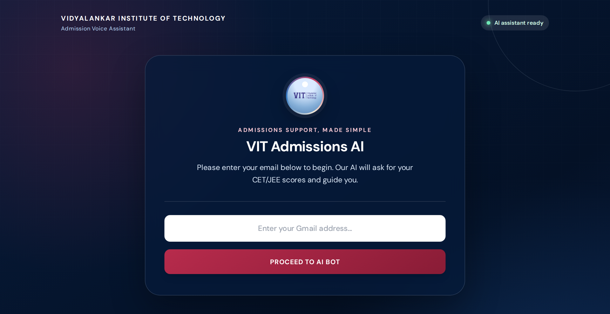
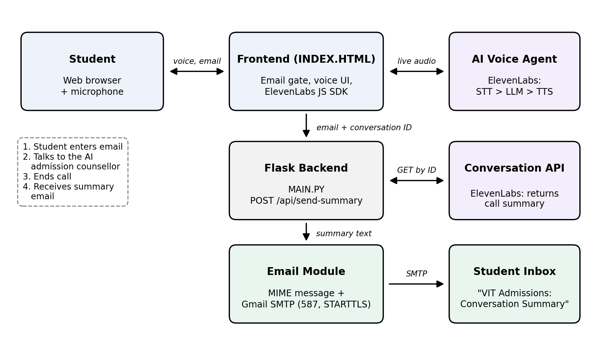
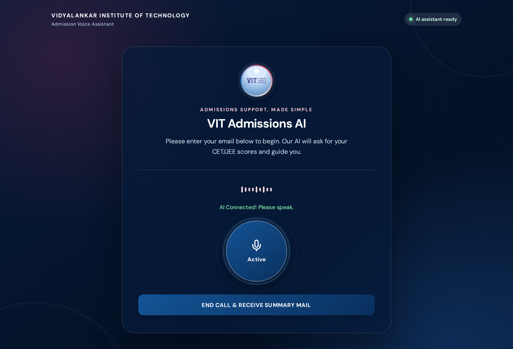
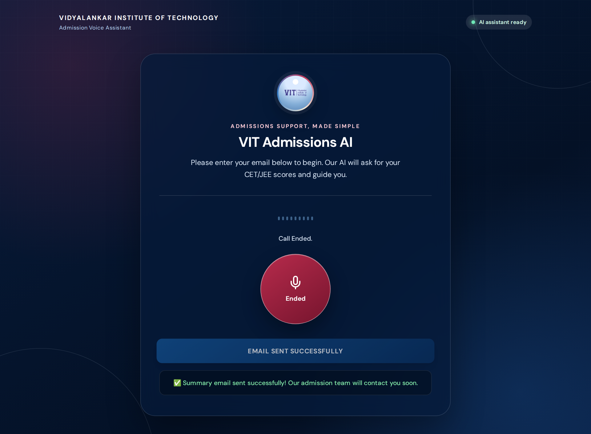
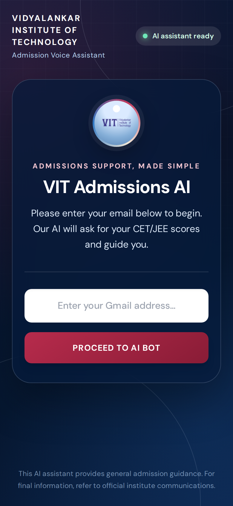
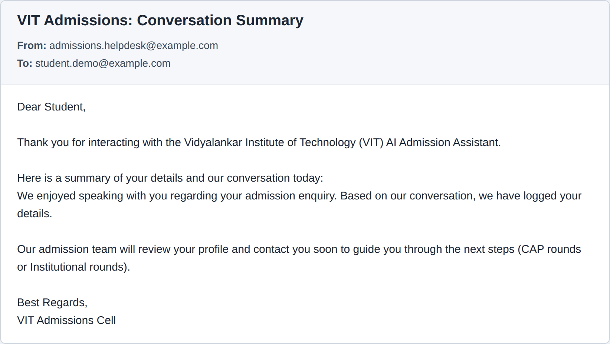

# Cognitive College Admission Helpdesk System

A voice-based AI admission counsellor for **Vidyalankar Institute of Technology (VIT)**.
A student opens the website, enters an email address and **talks** to an AI admission assistant about
CET/JEE scores, eligibility, branches and the admission process. When the call ends, the system
automatically **emails the student a summary of the conversation**.

> Specialization Based Project — TY B.Tech Information Technology, Semester V (2026–2027)
> Department of Information Technology, Vidyalankar Institute of Technology, Mumbai



## Features

- **Natural voice conversation** with an AI admission counsellor, directly in the browser
- **Context memory** – details shared once (scores, preferred branch) are remembered during the call
- **Automatic summary email** sent to the student after every call
- **Secure email delivery** through Gmail SMTP with TLS encryption (STARTTLS, port 587)
- **Fallback handling** – a default confirmation email is sent if the AI summary is not ready
- **Responsive UI** that works on desktop and mobile

## System Architecture



1. The student enters an email address on the website and starts the call.
2. The browser connects to the **ElevenLabs AI voice agent** (Speech-to-Text → LLM → Text-to-Speech) for a live conversation.
3. When the call ends, the frontend sends the email address and conversation ID to the **Flask backend** (`POST /api/send-summary`).
4. The backend fetches the AI-generated summary from the **ElevenLabs Conversation API**.
5. The **email module** builds a MIME email and sends it via **Gmail SMTP** to the student's inbox.

## Tech Stack

| Layer | Technology |
|---|---|
| Frontend | HTML, JavaScript, Tailwind CSS, ElevenLabs JS SDK |
| Voice AI | ElevenLabs Conversational AI agent (STT, LLM, TTS) and Conversation API |
| Backend | Python, Flask |
| Email | Python `smtplib` + `email.mime`, Gmail SMTP (TLS) |
| Config | python-dotenv (`.env` file for credentials) |

## Project Structure

```
├── MAIN.PY              # Flask backend: serves the page and sends the summary email
├── templates/
│   └── INDEX.HTML       # Frontend: email gate, voice UI, ElevenLabs connection
├── screenshots/         # Images used in this README
├── requirements.txt     # Python dependencies
├── .env.example         # Template for the credentials file
└── .gitignore
```

## How to Run

**Requirements:** Python 3.10+, Google Chrome, a microphone and an internet connection.

```bash
# 1. Clone the repository
git clone https://github.com/Swapnilbhabal/Cognitive-College-Admission-Helpdesk.git
cd Cognitive-College-Admission-Helpdesk

# 2. Create and activate a virtual environment
python -m venv .venv
.venv\Scripts\activate          # Windows
# source .venv/bin/activate     # macOS / Linux

# 3. Install dependencies
pip install -r requirements.txt

# 4. Create the .env file
#    Copy .env.example to .env and fill in your Gmail address,
#    Gmail App Password and ElevenLabs API key.

# 5. Start the server
python MAIN.PY
```

Open **http://localhost:5000** in Chrome, enter your email, allow microphone access, talk to the
assistant, then click **End Call & Receive Summary Mail**.

> **Gmail App Password:** enable 2-Step Verification on your Google account, then create one at
> Google Account → Security → App passwords. A normal Gmail password will not work.

## Screenshots

| Call active | Email sent | Mobile view |
|---|---|---|
|  |  |  |

**Summary email received by the student**



## Future Scope

- Answers grounded in official VIT documents using Retrieval-Augmented Generation (RAG)
- Eligibility predictor based on marks, category and historical cut-offs
- Hand-off of unclear cases to a human counsellor dashboard
- Support for regional languages such as Marathi and Hindi
- Cloud deployment over HTTPS with HTML-formatted emails

## Team

| Name | Roll No. |
|---|---|
| Khatokar Gauri Sanjay | 24101B0009 |
| Bhabal Swapnil Sunil | 24101B0065 |
| Bhogavkar Aditya Vilas | 24101B0072 |
| Rathod Pearl Hitesh | 24101B0079 |

**Project Guide:** Prof. Pallavi Kharat
